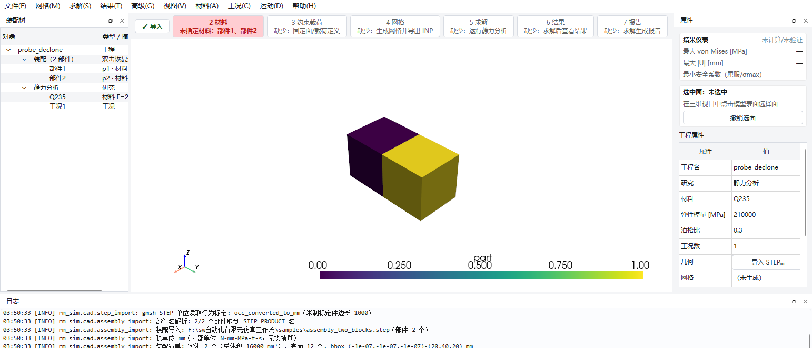
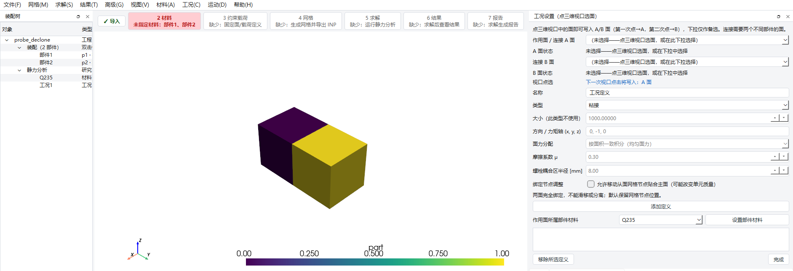
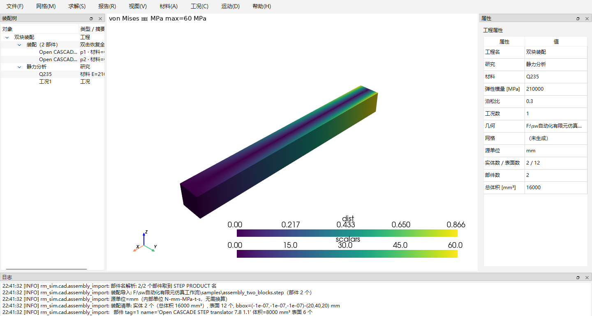
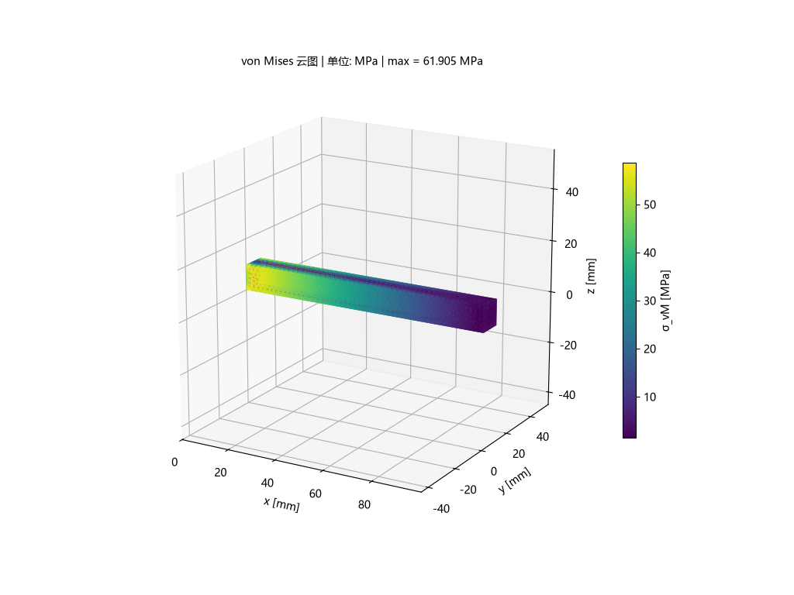

<div align="center">

# RM 仿真软件 · rm-sim

**面向机器人结构设计的桌面有限元仿真软件**

导入 STEP → 点三维面加约束与载荷 → 自动网格 → CalculiX 求解 → 云图与中文报告

[](#快速开始)
[](https://www.dhondt.de/)
[](LICENSE)
[](#已知限制与诚实边界)

</div>



> 一套为 RoboMaster 机械组日常结构评审打磨的仿真工具：不需要懂有限元命令、单位换算或网格文件格式，
> 鼠标点面就能完成「这个支架能不能扛住 1000 N」这类问题的闭环。
>
> *A desktop FEA application for robotics structures: STEP in, pick faces, solve with CalculiX, and get stress/displacement plots plus a Chinese report — including honest limits.*

---

## 目录

- [为什么做这个](#为什么做这个)
- [功能一览](#功能一览)
- [界面](#界面)
- [快速开始](#快速开始)
- [单位制与约定](#单位制与约定)
- [架构](#架构)
- [验收与质量](#验收与质量)
- [已知限制与诚实边界](#已知限制与诚实边界)
- [文档索引](#文档索引)
- [许可证与致谢](#许可证与致谢)

## 为什么做这个

RoboMaster 赛季里，机械组的迭代节奏是「今天改一版碳板/支架，明天就要上场」。
每次改动都要回答：**够不够强、变形多大、哪里先坏**。

商业 CAD 自带的仿真模块通常要额外许可、学习成本高，而且把「建模 → 设置 → 求解 → 写报告」割裂在多个软件里。
这个项目把这条链路做成一个中文桌面软件：

- **面向非 CAE 专业用户**：约束、载荷、连接都用「点部件的面」完成，不填面号/节点号；
- **可追溯**：每次求解落盘完整输入（INP）、求解器日志、原始 FRD/DAT、`results.json` 与 Markdown 报告；
- **不虚报**：没有求解证据时界面显示「未计算/未验证」，报告里显式列出假设、局限与未验证项。

项目自 2026 年 10 月底开始，按模块逐步迭代（`app/docs/module_01`–`module_59`，含中途合并的缺号），
配套 81 个门脚本与 9 个公共模块；所有数值结论都用理论解、
原始产物复算或变异测试交叉核对过。开发过程中的取舍与踩坑记录在 `app/docs/module_*.md`。

## 功能一览

### 零件静力分析

- STEP 导入（OCC/gmsh），导入即做**单位三检**、实体检查与表面清单；
- 材料库：常用钢/铝/钛等，弹塑性参数分列；支持按名称推荐材料；
- 约束与载荷：固定面、面力、压力、力矩（对轴矩守恒）、重力（mm/s²）；
- gmsh 网格：全局尺寸、局部加密、质量报告与差单元定位；
- CalculiX 静力求解：真实子进程、日志门、退出码不盲信；
- 结果：von Mises / 位移云图、变形缩放、支反力合力表、极值仪表、安全系数与可信度徽章；
- 报告：Markdown + 云图 PNG，含假设与离散误差说明。

### 装配体

- 多实体 STEP → 部件树（双击单独显示/恢复、F2 重命名）；
- 连接模型：**粘接（TIE）/ 可分离接触（Coulomb 摩擦）/ 螺栓 / 销轴**，含绑定带（按实测几何挑出能绑上的节点）与连接复核；
- 自动识别贴合面并生成连接草稿，逐条勾选；装配间隙与接触候选检查；
- 装配级约束/载荷按 `(部件, 面指纹)` 挂接，重开工程后按几何指纹重新定位，绝不静默跨部件贴面；
- 真实装配求解、部件结果切换、组装级支反力与界面力核对。

### 模态与运动

- 单零件与整装绑定装配模态：频率列表、振型动画、刚体模态识别与说明；
- Project Chrono 刚体运动仿真 → 单时刻载荷传递 → 结构静力（独立 Python 3.12 环境，不污染主环境）；
- 运动/跌落/塑性等高级算例以**最小可验证算例**形式提供，边界写进报告。

### 工程与运行

- `.rmsimproject` 工程保存/重开重算，历史工况保留；
- 后台任务、取消、进程组回收、内存预算守卫（超限即停并落证据）；
- 批处理入口（`--batch`）与无头自检（`--selfcheck`），可接入 CI。

## 界面

| 装配与设置面板 | 结果云图 |
|---|---|
|  |  |

无 GL 桌面会话时的静态回退渲染（Agg）也能出云图：



## 快速开始

### 1. 环境

- **Python 3.12 或 3.13**（开发与验收环境：3.13.3）；
- **CalculiX 2.22**（独立可执行文件；本项目不捆绑其二进制）；
- Windows 10/11 为第一优先平台（GUI/VTK 与 `ccx_launcher.exe` 在该平台验证）。

### 2. 安装

```powershell
git clone https://github.com/HLX-CPU/rm-sim.git
cd rm-sim
py -3.13 -m venv .venv
.\.venv\Scripts\python.exe -m pip install -U pip
.\.venv\Scripts\python.exe -m pip install -r requirements.txt
```

### 3. 配置求解器

```powershell
Copy-Item config.example.json config.json
# 编辑 config.json，把 ccxPath 指向本机的 CalculiX 可执行文件
```

`config.json` 的解析顺序：

1. 环境变量 `RM_SIM_CONFIG` 指定的路径；
2. 仓库根目录的 `config.json`；
3. 旧工作区兜底路径 `E:/rm_sim/config.json`。

CalculiX 可从 <https://www.dhondt.de/> 获取（GPL 软件，本项目仅以子进程调用，不链接、不再分发）。

### 4. 启动

```powershell
.\.venv\Scripts\python.exe main.py          # GUI
```

或双击 `启动仿真软件.bat`（自动依次查找 `.venv`、`venv`、`RM_SIM_PYTHON`、PATH 上的 python）。

无头自检（不弹窗，检查依赖/配置/窗口/视口降级）：

```powershell
$env:QT_QPA_PLATFORM = "offscreen"
.\.venv\Scripts\python.exe main.py --selfcheck
```

### 5. 跑一个示例

```powershell
.\.venv\Scripts\python.exe main.py --batch examples\part_beam.json
```

产物在 `examples/part_beam/cases/case_001/`：`solve.inp`、`solve.log`、`solve.dat`、`solve.frd`、
`results.json`、`report.md`、`mises.png`、`displaced.png`。
装配接触示例用 `examples\assembly_contact.json`。

在 GUI 里「文件 → 打开工程」打开 `.rmsimproject`，可以继续改定义、重算并保留旧工况。

## 单位制与约定

内部统一使用 **N–mm–MPa–t–s**：

| 量 | 单位 |
|---|---|
| 长度 | mm |
| 力 | N |
| 应力/模量 | MPa |
| 质量 | t |
| 重力加速度 | mm/s²（9810） |
| 密度 | t/mm³（钢 7.85e-9） |

导入非 mm 的 STEP 时会按声明换算并写日志；缺失单位声明按 mm 处理并告警。

## 架构

```
rm-sim/
├─ main.py                     # 统一入口：GUI / --selfcheck / --batch / --smoke
├─ 启动仿真软件.bat
├─ app/
│  ├─ ARCHITECTURE.md          # 分层与目录约定（权威）
│  ├─ docs/                    # 49 篇模块设计说明 + 连接物理假设 + UX 规范
│  └─ rm_sim/
│     ├─ cad/                  # STEP 导入、装配解析、单位三检、面拾取、SolidWorks 可选入口
│     ├─ core/                 # 工程模型、材料库、连接模型、面/部件指纹、工程打包
│     ├─ mesh/                 # gmsh 网格、局部加密、网格数据
│     ├─ solver/               # INP 编译、CalculiX 调度、结果解析、模态、Chrono、守卫
│     ├─ gui/                  # 主窗口、视口、对话框、面板、主题
│     └─ report/               # Markdown 报告、云图与聚合
├─ verify/                     # 81 个 verify_*.py 门脚本 + 公共工具 + 回归编排
├─ samples/                    # 可复现的 STEP 样例
├─ examples/                   # 批处理算例规格（产物运行后生成，不入库）
├─ tools/                      # SolidWorks 插件（C#/VBA）与装配导出辅助
├─ docs/images/                # README 配图
└─ 使用说明.md                  # 面向使用者的完整操作手册
```

分层规则：`cad / core / mesh / solver / report` 不导入 Qt；GUI 只做编排与展示；
所有数值落盘都经过 solver 层，报告与界面消费同一份 `results.json`。

## 验收与质量

仓库里的 `verify/` 不是演示脚本，而是开发期真实跑过的验收门：

- **81 个门脚本（`verify_*.py`）与 9 个公共模块**，覆盖入口、导入、材料、载荷、网格、求解、结果、报告、装配、连接、模态、
  Chrono、后台任务、内存守卫、取消与故障路径；
- 默认回归 40 门（`verify/run_regression.py`），另有 2 门分钟级慢速门（`--slow`）；
- 每门输出「原始产物 + 断言日志 + PASS/FAIL」；会记录求解器原始 INP/LOG/DAT/FRD，
  而不是只留一行结果；
- 大量门用**变异测试**证明自己会咬人（改错数据必须失败），并配有独立复算（原始产物重算，
  不复用实现内部函数）；
- 套件按 `fast_config / real_small / reliability / full` 四层标签分类，标签只影响选择与报告，
  不改变任何门的阈值。

运行方式（示例）：

```powershell
.\.venv\Scripts\python.exe verify\run_regression.py --only main_entry,step_import
```

验收脚本默认沿用开发期路径约定：证据根目录 `E:/rm_sim/verification`、解释器 `E:/rm_sim/venv`。
它们从环境变量读取覆盖值：`RM_SIM_VERIFICATION_ROOT`、`RM_SIM_PYTHON`，
`RM_SIM_CONFIG`（主程序配置），以及 `RM_SIM_BASELINE_DB`（可选的基线运行库交叉核对）。

## 已知限制与诚实边界

这是一个**工程实用工具**，不是商业 CAE 的替代品。以下限制是设计取舍，均在报告与界面中显式声明：

- **平台**：GUI/VTK 与求解器启动在 Windows 上验证；SolidWorks 原生装配导入依赖 Windows + SolidWorks COM（可选，纯 STEP 流程不需要 SW）；
- **求解器**：需要单独安装 CalculiX；本项目不捆绑、不修改其二进制；
- **规模**：面向中小模型（示例 2 万节点级）；有内存预算守卫，超限会停止而不是拖垮机器；
- **接触**：面-面简化接触与 TIE，绑定带按几何挑选节点；不是商业软件的完整接触算法；
- **材料**：线弹性 + 双线性各向同性硬化塑性（最小算例，参数未经材料试验标定）；
  **损伤分析未实现**，不会生成任何损伤卡；
- **几何非线性**：未启用 NLGEOM，小应变假设；无壳单元、无复合材料；
- **模态**：线性无预应力；整装模态只在绑定连接下验证；
- **Chrono 运动/跌落**：刚体动力学到结构的单向载荷传递；跌落冲击为准静态近似，
  **未计算应力波、未启用塑性，碰撞应力不可信**（报告有红线断言）；
- **报告与界面文案**中的「未验证/未计算」不是装饰：没有证据就不出数字。

## 文档索引

| 文档 | 内容 |
|---|---|
| [使用说明.md](使用说明.md) | 面向使用者的完整操作手册（界面、点面、连接、结果、报告） |
| [app/ARCHITECTURE.md](app/ARCHITECTURE.md) | 分层、目录约定、模块边界与数据流（权威） |
| [app/docs/](app/docs/) | 49 篇模块设计说明：为什么这样做、验证了什么、留下了什么限制 |
| [app/docs/connections.md](app/docs/connections.md) | 连接类型的物理假设与适用边界 |
| [app/docs/ux-design.md](app/docs/ux-design.md) | 界面设计规范 |
| [交付报告.md](交付报告.md) | 2026-11-04 接续交付的验收结论与证据索引 |

## 许可证与致谢

本项目以 **MIT License** 发布，见 [LICENSE](LICENSE)。

它站在这些开源项目肩上：

- [CalculiX](https://www.dhondt.de/) —— 有限元求解器（GPL，独立进程调用）；
- [gmsh](https://gmsh.info/) —— 几何与网格；
- [PyVista](https://pyvista.org/) / [VTK](https://vtk.org/) —— 三维可视化；
- [PySide6 / Qt](https://doc.qt.io/qtforpython/) —— 桌面界面；
- [meshio](https://github.com/nschloe/meshio)、[ccx2paraview](https://github.com/calculix/ccx2paraview) —— 网格与结果格式；
- [Project Chrono](https://projectchrono.org/) —— 刚体动力学；
- [NumPy](https://numpy.org/)、[Matplotlib](https://matplotlib.org/) —— 数值与绘图；
- [PrePoMax](https://prepomax.fs.um.si/) —— 开发期求解器封装方式的参考。

---

<sub>如果这个项目对你有帮助，欢迎 Star / Issue / PR。涉及求解器数值的问题，请附上 `results.json` 与 case 目录，方便复现。</sub>
